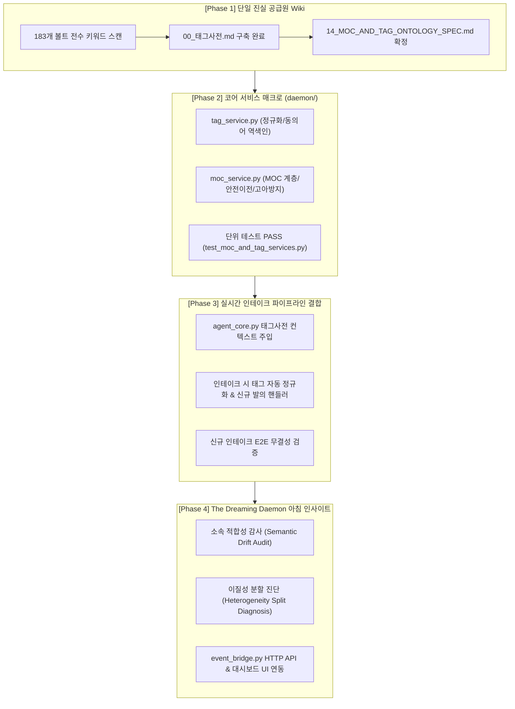

# 14. MOC & 태그 지식 온톨로지 거버넌스 및 아침 인사이트 고도화 스펙 (MOC & Tag Ontology Governance Spec)

> **최종 개정일**: 2026-10-14  
> **상태**: 구현 진행 중 (In Progress)  
> **Ground Truth**: `/Users/grasshop/Desktop/구직/경험정리/00_태그사전.md`, `/Users/grasshop/Desktop/구직/경험정리/00_헌법.md`

---

## 1. 개요 및 배경 (Overview & Philosophy)

### 1.1 배경
Subrain_98의 지식 그래프와 옵시디언 볼트가 180개 이상의 노드로 성장함에 따라 다음과 같은 구조적 병목이 도출되었다:
1. **MOC(Map of Content)의 임의 생성 및 경계 모호성**:
   - MOC는 일반 메모가 아닌 지식 온톨로지의 최상위 척추이자 헌법급 거버넌스 자산임에도, 에이전트가 편의에 따라 임의로 신설(`MOC_금융시장` 등)할 위험이 존재함.
   - 하나의 거대 MOC(예: `MOC_커리어`) 아래에 30~100개의 노드가 수평(Flat)하게 쌓여 인지 부하가 증가하고 내부 이질성이 발생함.
2. **태그 엔트로피 폭발 (Tag Entropy Explosion)**:
   - 신규 인테이크 시 LLM이 자유 생성(Free-generation) 방식으로 역량/상황 태그를 지어내어, `#갈등조정`, `#갈등해결`, `#협상` 등 동의어가 무한히 분열되고 검색 재현율(Recall)이 파괴됨.
3. **맥락(Context)의 실체적 정의**:
   - 빅데이터 벡터 검색과 달리, 고밀도 개인 지식 베이스에서는 **"500~800자 단일 인과 완결체(One Causal Narrative Arc)"**가 최소 맥락 단위이며, **"이유가 명시된 수평선 + 2단계 MOC 성단"**이 결합 단위임.

---

## 2. 아키텍처 5대 핵심 불변식 (System Invariants)

| 불변식 | 규칙 내용 | 엔지니어링 방어 기제 |
| :--- | :--- | :--- |
| **1. MOC 인간 개입 독점 (HITL Governance)** | AI 에이전트는 새로운 `MOC_*.md` 파일을 스스로 생성할 수 없음. | 자율 파일 쓰기 차단, 오직 발의(Proposal) 객체만 발행하며 인간 승인 시에만 `MOCService` 매크로 실행 |
| **2. 2단계 성단 깊이 제한 (Max 2-Level Depth)** | `[최상위 MOC(태양)] ➔ [하위 MOC(행성)] ➔ [개별 노드(위성)]`의 최대 2단계로 제한. | 윈도우 폴더 트리식 관료화 원천 방지 (`sub_moc`의 부모는 4대 헌법 MOC만 허용) |
| **3. 단일 진실 공급원 Wiki (Ground Truth Lexicon)** | 볼트 내 `00_태그사전.md`에 등재된 공식 표준 태그만 사용. | LLM 자유 생성 금지, 동의어 역색인 자동 정규화(Canonicalization), 미등재 태그는 인간 승인 대기열로 분리 |
| **4. 4대 헌법 MOC 삭제 불가 (Permanent Spine)** | `MOC_커리어`, `MOC_지식원리`, `MOC_지원전략_합격패턴`, `MOC_아이디어` 영구 보호. | `MOCService.safe_delete_moc()` 호출 시 `PermissionError` 강제 발생 |
| **5. 고아 노드 원천 방지 (Zero-Orphan Invariant)** | 하위 MOC 삭제/분할 시 자식 노드의 링크가 유실되는 것 방지. | 하위 MOC 삭제 전 모든 자식 노드를 `fallback_moc`로 선제 일괄 이전(Reassign) 후 파일 삭제 |

---

## 3. 4단계 엔지니어링 구현 로드맵 (Bottom-Up Service Sandwich)

---

## 4. 세부 모듈 및 인터페이스 스펙

### 4.1 Phase 1: `00_태그사전.md` 구조 스펙
- 경로: `/Users/grasshop/Desktop/구직/경험정리/00_태그사전.md`
- 마크다운 파싱 규격:
  - `## 1. 핵심 역량 축 (Competency)`: `- **#역량/표준명**: 정의문 (동의어/유의어 매핑: [유의어1, 유의어2, ...])`
  - `## 2. 상황 및 맥락 축 (Situation Context)`: `- **#상황/표준명**: 정의문 (동의어/유의어 매핑: [유의어1, 유의어2, ...])`
  - `## 3. 비즈니스 도메인 축 (Business Domain)`: `- **#도메인/표준명**: 정의문`

### 4.2 Phase 2: 코어 서비스 매크로 (`tag_service.py`, `moc_service.py`)
- `TagRegistry` ([daemon/tag_service.py](file:///Users/grasshop/Desktop/Antigravity/Subrain_98/SUBrain_98/daemon/tag_service.py)):
  - `load_from_vault()`: `00_태그사전.md` 파싱하여 공식 태그 및 동의어 색인 로드.
  - `canonicalize(raw_tag) -> (canonical_tag, is_mapped)`: 동의어 자동 정규화.
  - `canonicalize_list(tags) -> (mapped_tags, unmapped_tags)`: 일괄 정규화 및 미등재 태그 분리.
  - `get_allowed_tags_summary() -> str`: LLM 프롬프트 주입용 요약본 생성.
  - `propose_new_tag(raw_tag, category, rationale) -> dict`: HITL 승인용 발의 객체 발행.
- `MOCService` ([daemon/moc_service.py](file:///Users/grasshop/Desktop/Antigravity/Subrain_98/SUBrain_98/daemon/moc_service.py)):
  - `list_mocs() -> List[dict]`: 4대 헌법 MOC 및 하위 MOC 목록, 자식 노드 통계 반환.
  - `create_sub_moc(name, parent_moc, description, initial_nodes) -> Path`: 하위 MOC(2계층) 안전 생성.
  - `reassign_node_moc(note_name, target_moc) -> bool`: 개별 노드의 Frontmatter `moc:` 및 링크 안전 이전.
  - `batch_reassign_nodes(note_names, target_moc) -> dict`: 노드 일괄 이전.
  - `safe_delete_moc(moc_name, fallback_moc) -> bool`: 자식 노드 안전 대피 후 하위 MOC 파일 삭제.

### 4.3 Phase 3: 실시간 인테이크 파이프라인 결합
- `agent_core.py`:
  - `generator_prompt`에 `tag_registry.get_allowed_tags_summary()` 주입.
  - LLM의 `competencies` 출력을 `tag_registry.canonicalize_list()`로 전수 검사.
  - 미등재 태그 감지 시 `critic_log`에 `[신규 발의]` 기록 및 대시보드 카드에 발의 안내 렌더링.

### 4.4 Phase 4: 아침 인사이트 (The Dreaming Daemon)
- `daemon/dreaming_daemon.py`:
  - `audit_moc_relevance(moc_name: str) -> dict`:
    - 해당 MOC의 소속 노드들을 LLM이 읽고 성격이 맞지 않는 노드 탐지.
    - 사람이 읽기 편한 자연어 브리핑 생성: *"이 노드는 MOC_지식원리로 옮기는 게 좋겠습니다"*.
  - `diagnose_moc_heterogeneity(moc_name: str) -> dict`:
    - 소속 노드들이 20개 이상일 때, LLM이 군집의 이질성을 분석.
    - 2~3개의 뚜렷한 세부 축이 보이면 하위 MOC 분할 제안 브리핑 생성.
- `daemon/event_bridge.py`:
  - `/api/moc/list`, `/api/moc/reassign`, `/api/tags/registry`, `/api/moc/audit` HTTP 엔드포인트 장착.

---

## 5. 검증 및 테스트 계획
1. **단위 테스트 (`tests/test_moc_and_tag_services.py`)**: 완료 (100% PASS)
2. **E2E 인테이크 통합 테스트 (`tests/simulate_intake_and_e2e.py`)**: Phase 3 검증
3. **아침 인사이트 분석 검증**: 실제 183개 볼트 노드 대상 적합성/분할 분석 트레이스 검증
4. **브라우저 대시보드 실측 검증**: 계층형 MOC 및 통제 태그 시각화 확인
