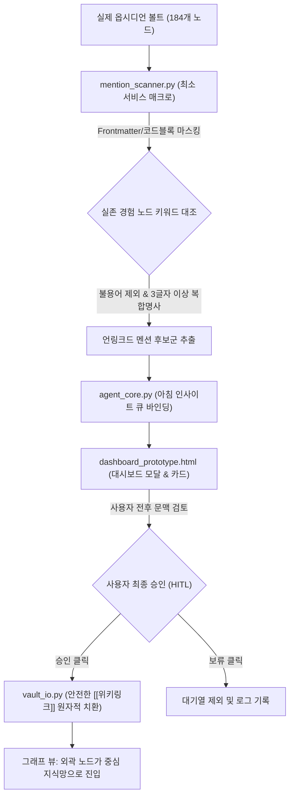

# 15_HORIZONTAL_UNLINKED_MENTIONS_SPEC: 수평 언링크드 멘션 안전 감지 및 HITL 결속 시스템

## 1. 문제의식 및 추진 배경 (Why & Context)

### 1.1 현상 및 볼트 실측 진단
* **고립 노드 71개의 실체**:
  - 볼트 내 184개 노드 중 연결선이 0개인 외곽 고립 노드가 71개에 달함.
  - 전수 조사 결과, 순수 경험 카드(`경험_...`) 31개는 100% 연결되어 있으나, 자소서/지원 메모(`지원_2026_굿네이버스.md` 등)는 실제 본문에 `넥스트러너스 자발적 참여구조`, `둥지 커뮤니티사업` 등 내 경험의 핵심을 녹여 썼음에도 **명시적 위키링크 문법(`[[...]]`)이 누락되어 지식 그래프 외곽에 방치**됨.
* **사용자 핵심 지침**:
  - *"AI에게 모든 걸 위임하고 결정짓게 하면 오류가 날 수 있으니까 차근차근 수정해나갈 수 있도록 하자."*
  - 완전 자동 연결은 엉뚱한 동음이의어 결속이나 원문 훼손을 초래하므로, **"사서(LLM)의 정밀 탐지 ➔ 인간의 눈 검토 ➔ 승인 시 안전 치환"**의 3단계 파이프라인 필수.

---

## 2. 비판적 위험 분석 및 3대 불변식 (Invariants & Guardrails)

### [위험 1]: 과잉 매칭(False Positives) 및 링크 오염(Link Pollution)
* **위험**: "지원", "경험", "기획", "고객" 등 일반적인 한국어 명사를 노드명과 단순 매칭하면 모든 문장에 `[[...]]`가 덕지덕지 붙어 가독성과 그래프가 파괴됨.
* **방어 불변식 (Strict Matching Invariant)**:
  1. 최소 길이 제약: 접두사(`경험_`, `지식_` 등)를 제외한 핵심 명칭이 **3글자 이상**이며 **2개 이상의 형태소/복합명사**로 구성된 실존 노드만 매칭 대상으로 허용 (예: `자발적참여구조`, `고객불신전환`, `AI커리큘럼`).
  2. 불용어(Stopwords) 블랙리스트: `경험`, `지원`, `보고서`, `초안`, `기업분석`, `정리`, `기획`, `검토` 등 단독 일반 명사는 후보 탐지에서 원천 제외.
  3. 신뢰도 임계값: 문맥 일치 점수(Context Relevance Score) 85점 이상만 상신.

### [위험 2]: 마크다운 원문 파괴 및 멱등성(Idempotency) 결여
* **위험**:
  - 이미 `[[경험_A]]`로 감싸진 곳에 다시 `[[[[경험_A]]]]`로 감싸는 중복 치환 버그.
  - YAML Frontmatter, 코드 블록(```` ``` ````), 인라인 코드(` ` `), 외부 URL(`http://...`) 내부의 텍스트를 무차별 치환하여 파일이 깨지는 현상.
* **방어 불변식 (Syntax-Safe Tokenizer)**:
  - 파일 파싱 시 Frontmatter, Code Block, 이미 존재하는 Wikilink 구간을 먼저 마스킹(Masking)한 후, 순수 본문(Prose) 영역에서만 단어를 탐지하고 안전하게 치환.
  - 치환 전 원본 해시(Hash) 및 스냅샷을 백업하여 충돌 방지(`vault_io.update_note`).

### [위험 3]: AI의 자율 수정 금지 (Zero Silent Modification)
* **위험**: 백그라운드 데몬이 사용자 모르게 디스크 볼트 파일을 멋대로 수정하는 행위.
* **방어 불변식 (HITL Approval Gate)**:
  - 데몬은 **'읽기 전용(Read-Only)'**으로 탐지하여 오직 아침 인사이트 대기열(Queue)에 제안 카드로만 상신.
  - 사용자가 대시보드 모달에서 인용 전후 문맥을 직접 눈으로 대조하고 `[승인]` 버튼을 눌렀을 때만 WebSocket API를 통해 단일 원자적 쓰기(Atomic Write) 수행.

---

## 3. 시스템 아키텍처 및 4단계 로드맵



### [Phase 1] 언링크드 멘션 탐지 서비스 매크로 구축 (`daemon/mention_scanner.py`)
1. `list_linkable_entities()`:
   - 볼트 내 `경험_...` 및 `지식_...` 노드 38개 전수 수집.
   - 접두사 제거 및 정규화된 매칭 키워드 딕셔너리 구축 (예: `넥스트러너스 자발적 참여구조` ➔ `경험_넥스트러너스_자발적참여구조`).
2. `scan_unlinked_mentions(doc_name)`:
   - 특정 문서(예: `지원_2026_굿네이버스.md`)의 본문을 안전하게 파싱하여 마스킹.
   - 키워드가 등장한 정확한 행 번호(Line Number), 앞뒤 100자 인용 문맥(Context Excerpt) 추출.
3. 단위 테스트: `tests/test_mention_scanner.py` 구축하여 오탐지 0건 및 코드블록/중복링크 예외 처리 100% PASS 검증.

### [Phase 2] 안전한 원문 위키링크 치환 매크로 (`daemon/mention_service.py`)
1. `apply_wikilink_safely(source_doc, target_entity, exact_phrase)`:
   - `vault_io.read_note`로 읽고 해시 검증.
   - 마스킹된 본문 영역에서 해당 문구를 정확히 `[[target_entity|exact_phrase]]` 또는 `[[target_entity]]`로 1회 원자적 교체.
   - `vault_io.update_note`로 디스크 저장 및 백업.

### [Phase 3] 아침 인사이트 큐 & WebSocket 연동 (`agent_core.py`, `event_bridge.py`)
1. `agent_core.py`:
   - `generate_morning_insights()`에 `unlinked_mentions` 카테고리 추가.
   - 탐지된 수평 연결 후보를 신뢰도 90점 이상의 카드로 대시보드에 공급.
2. `event_bridge.py`:
   - `APPROVE_UNLINKED_MENTION` WebSocket 이벤트 핸들러 추가.
   - 클라이언트 승인 시 `apply_wikilink_safely` 호출 후 클라이언트에 실시간 브로드캐스트.

### [Phase 4] 대시보드 UI 대조 뷰 및 그래프 반영 (`dashboard_prototype.html`)
1. **아침 인사이트 카드 렌더링**:
   - `🔗 수평 지식 결속 (언링크드 멘션)` 뱃지 장착.
   - 원문 문서와 인용된 경험 카드 2-패널 프리뷰.
2. **상세 대조 모달**:
   - 좌측: 자소서 원문에서 해당 경험이 언급된 정확한 단락 하이라이트.
   - 우측: 결속 대상 경험 카드의 전문 마크다운 및 H1/태그 표시.
   - 하단: `[🔗 위키링크 수평 결속 승인]` 버튼.
3. **그래프 실시간 검증**:
   - 승인 즉시 D3 그래프 상에서 외곽에 홀로 있던 `지원_2026_굿네이버스`가 중심부의 `경험_넥스트러너스_자발적참여구조`와 굵은 네온 간선으로 즉각 연결되는 인터랙션 확인.

---

## 4. 데이터 인터페이스 정의 (TypeScript/JSON Interface)

```typescript
interface UnlinkedMentionItem {
  id: string; // 예: "MENTION-GN-01"
  type: "unlinked_mention";
  source_node: string; // 예: "지원_2026_굿네이버스"
  target_node: string; // 예: "경험_넥스트러너스_자발적참여구조"
  matched_text: string; // 예: "넥스트러너스 자발적 참여구조"
  line_number: number;
  source_context: string; // 앞뒤 100자 인용 문맥
  confidence_score: number; // 예: 94
  status: "PENDING" | "COMMITTED" | "DISMISSED";
  match_rationale: string; // "지원서 4번 문항에서 넥스트러너스 조직 참여 유도 경험을 인출하였으나 위키링크가 누락되어 있습니다."
  transfer_action: "해당 본문 문구를 [[경험_넥스트러너스_자발적참여구조]]로 안전 치환하여 지식망에 결속";
}
```

---

## 5. 인박스 부채 방어: 사용자 맞춤형 무의식 보관소 (Subconscious Archive Policy)

### 5.1 철학 및 Readwise 멘트 공식 채택
> *"정리하지 않은 것은 당신의 나태가 아니라, 뇌가 지금 당장 불필요하다고 판단한 건강한 망각(Active Forgetfulness)입니다. 무의식 보관소에 안전하게 잠재워둡니다."*

### 5.2 2계층 인출 아키텍처
1. **1계층 (Active Memory / Graph)**:
   - 사용자가 직접 검토/승인하여 수평/수직 연결선이 맺어진 정제된 고밀도 지식.
   - 전면 지식 관측창 및 아침 인사이트 대기열에서 활성 상태로 유지.
2. **2계층 (Subconscious Memory / Deep Archive)**:
   - 사용자가 설정한 보관 기간(기본 7일~30일) 동안 처리되지 않고 잔류한 카드.
   - 아침 대기열에서 조용히 침잠(Archive)되어 사용자 인지 부하와 죄책감을 0으로 초기화.
   - **인출 방식**: 글로벌 검색(⌘K) 시 1계층 매칭 결과 하단에 *"🌊 기억의 무의식 보관소에 잠든 관련 자료 (N건)"* 섹션으로 후순위 스크롤 렌더링.
3. **사용자 맞춤형 TTL (Retention Period Slider)**:
   - 대시보드 설정에서 7일 / 14일 / 30일 / 무제한 중 선택 가능.
